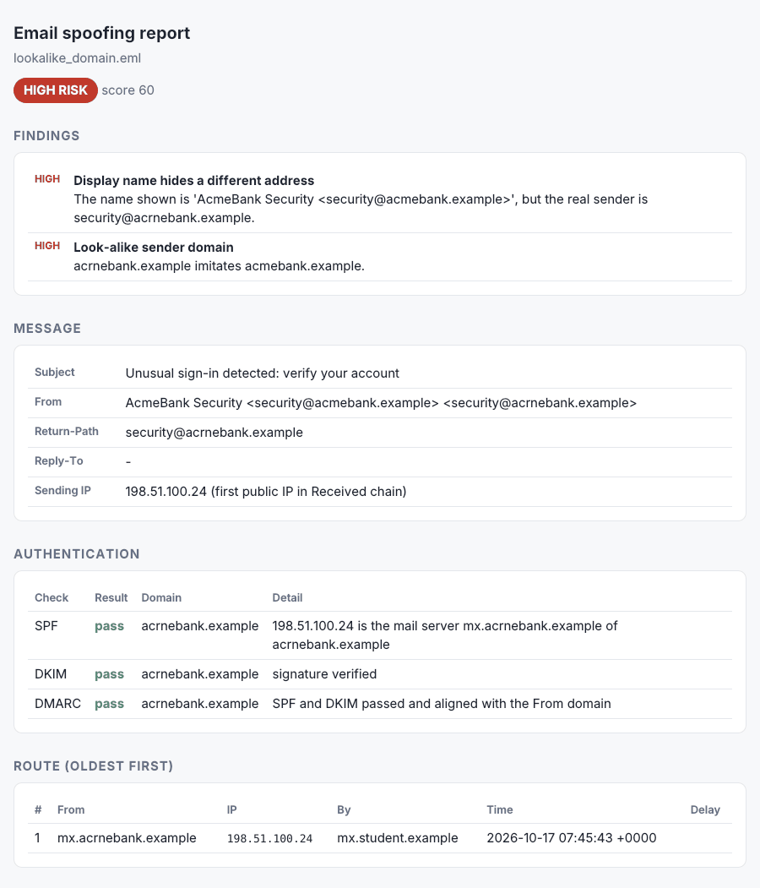
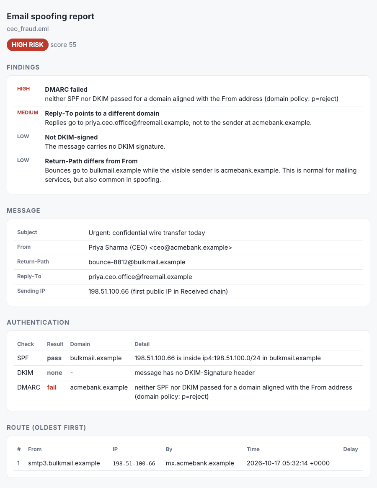

# Email Header & Spoofing Analyzer

A command-line tool that inspects a raw email (`.eml`) the way a SOC analyst would. It traces the route the message took, independently verifies **SPF, DKIM and DMARC** with live DNS lookups, and flags common spoofing tricks such as look-alike domains, hidden display-name addresses and hijacked Reply-To addresses.



## Why this matters

Email authentication passing does **not** mean an email is safe. In the sample above, the attacker registered `acrnebank.example` (where `rn` looks like `m`) and set up SPF, DKIM and DMARC correctly, so every authentication check passes. The tool still rates it **HIGH risk** because the identity checks catch the look-alike domain and the fake address hidden in the display name.

## Features

| Area | What it does |
| --- | --- |
| **Route tracing** | Parses every `Received:` header into hops (from host, IP, receiving server, protocol, time) and shows the delay between hops |
| **Sending IP** | Finds the IP that delivered the message, preferring the receiver's `Received-SPF` header, then the newest public IP in the chain |
| **SPF** | Implements RFC 7208 evaluation for `ip4`, `ip6`, `a`, `mx`, `include`, `redirect` and `all`, including the 10-DNS-lookup limit |
| **DKIM** | Cryptographically verifies every `DKIM-Signature` using the public key published in DNS |
| **DMARC** | Fetches the policy (with fallback to the organisational domain) and checks relaxed or strict **alignment** of SPF and DKIM with the From domain |
| **Spoofing rules** | Look-alike domains (typos, homoglyphs like `rn`/`m`, `0`/`o`, brand names inside domains), punycode domains, display names hiding another address, Reply-To redirection, Return-Path mismatch, Message-ID mismatch, out-of-order timestamps |
| **Output** | Coloured terminal report, a standalone HTML report, or JSON for scripts. The exit code (0/1/2) reflects the risk level |

## Quick start

```bash
git clone https://github.com/keerthyw/email-spoofing-analyzer.git
cd email-spoofing-analyzer
python3 -m venv .venv && source .venv/bin/activate
pip install -r requirements.txt

# Try the three demo emails (no internet needed)
python analyze.py samples/*.eml --dns-fixture samples/dns_fixture.json --protect acmebank.example
```

### Analyse your own emails

In Gmail, open an email, click **⋮ → Download message** to save it as a `.eml` file, then run:

```bash
python analyze.py ~/Downloads/message.eml                  # live DNS checks
python analyze.py ~/Downloads/message.eml --html report.html
python analyze.py ~/Downloads/message.eml --offline        # no DNS: use the receiver's verdicts
python analyze.py ~/Downloads/message.eml --json
```

| Option | Meaning |
| --- | --- |
| `--protect DOMAIN` | Add a domain to protect from look-alikes (common brands and Indian banks are built in) |
| `--ip IP` | Override the detected sending IP |
| `--dns-fixture FILE` | Answer DNS queries from a JSON file instead of the internet |
| `--offline` | Skip DNS entirely and use the `Authentication-Results` header written by the receiving server |

## Demo emails

`samples/make_samples.py` generates three emails, signs them with freshly created DKIM keys, and writes the DNS records they are checked against. All domains use the reserved `.example` TLD and all IPs come from documentation ranges.

| Sample | Scenario | SPF | DKIM | DMARC | Verdict |
| --- | --- | --- | --- | --- | --- |
| `legit_statement.eml` | Real bank notification | pass | pass | pass | LOW |
| `ceo_fraud.eml` | CEO impersonation sent through a bulk mailer, replies redirected to free mail | pass (wrong domain) | none | **fail** (p=reject) | HIGH |
| `lookalike_domain.eml` | Phishing from `acrnebank.example` with a fake address in the display name | pass | pass | pass | HIGH |



## How it works

```
.eml ──► parser.py ──► auth.py (SPF · DKIM · DMARC) ──► rules.py ──► report.py
          headers,       live DNS or JSON fixture       spoofing       terminal /
          hops, IP                                      indicators     HTML / JSON
```

- `spoofcheck/parser.py` decodes headers and builds the hop list
- `spoofcheck/auth.py` contains the SPF evaluator, DKIM verification and DMARC alignment
- `spoofcheck/domains.py` contains organisational-domain logic and look-alike detection
- `spoofcheck/rules.py` contains the spoofing indicators and risk scoring
- `spoofcheck/report.py` produces the terminal and HTML output

## Tests

```bash
python -m unittest discover tests
```

The 15 tests cover SPF evaluation (include, redirect, a/mx, lookup limit, duplicate records), look-alike detection, header parsing and end-to-end verdicts, including a check that editing the body of a signed email breaks DKIM.

## Limitations

- SPF macros and the `ptr`/`exists` mechanisms are skipped and reported, not evaluated.
- The organisational domain uses a built-in list of common multi-part suffixes (such as `co.in` and `co.uk`) instead of the full Public Suffix List.
- DKIM can fail on old emails if the sender has since rotated its keys, and SPF/DMARC results reflect today's DNS, not the DNS at delivery time. The tool shows the receiving server's original verdicts alongside its own so you can compare them.

## License

MIT
